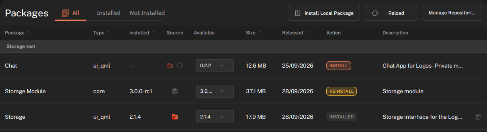
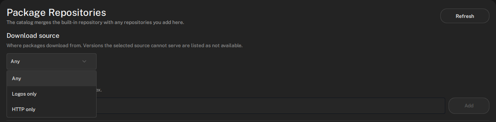
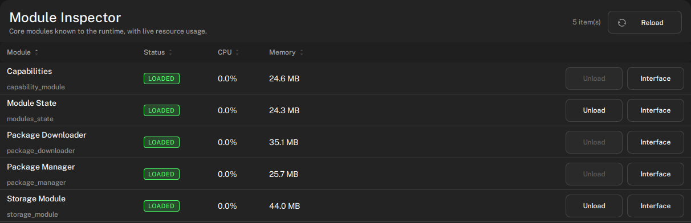

> Source: https://docs.logos.co/basecamp/install-and-load-module-in-basecamp
> Markdown index of all Logos docs: https://docs.logos.co/llms.txt

# Install and load a module in Basecamp

#### Access features and functionalities through modules in Logos Basecamp.

> **Tip: Version**
>
> This document is accurate for **Testnet v0.3**.

In Logos [Basecamp](https://docs.logos.co/get-started/glossary.md#basecamp), you can install and load modules that provide features like chat, storage, or wallets from the online [catalogue](https://docs.logos.co/get-started/glossary.md#catalogue) or local `.lgx` files.

There are two types of modules in Logos Basecamp. [Core modules](https://docs.logos.co/get-started/glossary.md#core-module) are the headless background services that provide capabilities like messaging or storage, while [UI modules](https://docs.logos.co/get-started/glossary.md#ui-module) are the visual front-ends users interact with. Both kinds of modules are packaged and distributed as [packages](https://docs.logos.co/get-started/glossary.md#package).

> **Info: Prerequisites**
>
>
> - [Basecamp installed and running](https://docs.logos.co/basecamp/install-logos-basecamp.md), version [0.3.2](https://github.com/logos-co/logos-basecamp/releases/tag/0.3.2) or later.
> - Internet access for online catalogue install.
> - [An `.lgx` file](https://docs.logos.co/core/build-modules/build-and-run-a-logos-core-module.md) for local install. Make sure that the archive contains a variant matching your platform.

## What to expect

- You can install a [module](https://docs.logos.co/get-started/glossary.md#module) from the online catalogue or from a local `.lgx` file.
- You can choose where Basecamp downloads packages from: the [Logos Storage](https://docs.logos.co/get-started/glossary.md#logos-storage) network, HTTPS, or either.
- You can load or unload a module from **Settings**: core modules under **Module Inspector**, UI modules under **Apps Inspector**.
- You can read a loaded module's status, CPU, and memory in **Settings > Module Inspector**. **Apps Inspector** shows a UI module's status and version, without live resource usage.

> **Tip**
>
> An introduction to modules in Logos Basecamp is available in video form:
> [Video: Understanding .lgx modules on Logos Basecamp](https://www.youtube.com/watch?v=yZ_93uAAY9A)

## Step 1: Install the module package

When installing a module, Logos Basecamp extracts the variant for your platform into your user modules directory (core modules) or user plugins directory (UI modules).

### Install from the online catalogue

1. At the bottom of the sidebar, click **Package Manager**.
1. Browse and locate the module you want. Use the **Categories** and **Types** filters or the search box. The **Type** column shows `core` for core modules and `ui_qml` for UI modules. Click a row to open its **Details** panel on the right.
1. Click **INSTALL** on the module's row. An **Install Package?** dialogue opens and lists any dependency changes. Click **Install** to confirm.
1. Wait until the row's **Action** column reads `INSTALLED`. Core modules then appear in **Settings > Module Inspector**. UI modules appear in the sidebar and in **Settings > Apps Inspector**.

### How Basecamp downloads a package

Basecamp ships with the `storage_module` module, which runs a Logos Storage node. A catalogue can publish a package version on Logos Storage with a `logos:` address, as well as over HTTPS. 

- When a package with the desired version is available on the Logos Storage network and the Storage node is running, Basecamp downloads the package from Logos Storage.
- When the Storage node is stopped, `storage_module` is not loaded, or the node is on another network than the catalogue, Basecamp downloads the package from the HTTPS URL.
- If the Logos Storage download takes too long, Basecamp stops it and downloads the package from the HTTPS URL.

The **Source** column of **Package Manager** shows where a package comes from. For a package that is not installed, it shows an icon for each source from which the package is available for download. For an installed package, it shows the source it was downloaded from. Hover over an icon to see the name of the package source.

### Choose the download source

1. At the bottom of the sidebar, click **Settings** , then click **Package Repositories**.
1. Under **Download source**, pick one value:
    - **Any**: Logos Storage when possible, HTTPS otherwise.
    - **Logos only**: only Logos Storage.
    - **HTTP only**: only the HTTPS URL.

    

If the selected source cannot serve a version, **Package Manager** shows it as **Not available** and you cannot install it.

### Install from a local `.lgx` file

1. At the bottom of the sidebar, click **Package Manager**.
1. Click **Install Local Package**.
1. Select the `.lgx` file, click **Open**, then click **Install** in the **Install Package?** dialogue.
1. Core modules appear in **Settings > Module Inspector**. UI modules appear in the sidebar and in **Settings > Apps Inspector**.

## Step 2: Load the module

Loading a module turns an installed module into a running service you can actually use. Each loaded Logos module runs in its own `logos_host` process, so memory usage increases with the number of loaded modules.

1. At the bottom of the sidebar, click **Settings** , then click **Module Inspector**, or **Apps Inspector** for a UI module.
1. Find the module in the list. Its **Status** column reads `NOT LOADED`.
1. Click **Load** next to the module. The status changes to `LOADED` and the **CPU** and **Memory** columns start reporting.

To open a UI module, click its icon in the sidebar.

> **Info**
>
> You can click **Unload** in **Settings > Module Inspector** or close the tab of a module to unload it. Unloading stops the module's host process but not its dependencies, which may still be in use by other modules or UI Apps.

## Troubleshooting

### The installed module doesn't appear in Module Inspector or Apps Inspector

Confirm the module actually installed: check its status in **Package Manager**.

- If installing from the online catalogue: if a package's row shows **Not available** instead of **Install**, it has no build for your platform, build type (dev, portable, or release), or architecture, or the [download source](#choose-the-download-source) you selected cannot serve it.
- If installing from a local `.lgx` file: Basecamp reports an error if the archive has no variant for your platform.

Either way, confirm the archive includes a variant matching your platform before reinstalling. If the package shows as installed in Package Manager but still doesn't appear in the relevant inspector, its manifest `type` may not match where you're looking—core modules only appear in Module Inspector, and UI modules (`ui_qml`) only appear in Apps Inspector.

### A package downloads over HTTPS instead of Logos Storage

Basecamp uses Logos Storage only when the Logos Storage node can serve the package.

1. Open **Settings > Package Repositories** and check that **Download source** is not **HTTP only**.
1. Open **Settings > Module Inspector** and check that **Storage Module** (`storage_module`) reads `LOADED`. If it doesn't, click **Load**.

    

1. If you installed the **Storage** app, open it and check that the node is running. A package download will not begin if your Storage node is stopped.

### A QML-based UI App cannot reach the network

By design, QML UI Apps run inside a sandboxed QML engine with a deny-all QNetworkAccessManager and a URL interceptor that whitelists only the app's own directory. To make network calls, route them through a Logos Module, which runs in its own unsandboxed process. Use `logos.callModule("<module>", "<method>", [args])` from QML.
