# Run a Logos Blockchain node from Basecamp

#### Install the blockchain modules and run a syncing testnet node from the Basecamp desktop app.

:::tip[Version]
This document is accurate for **Testnet v0.3**.
:::

The [Logos Blockchain](../../get-started/glossary.md#logos-blockchain) is the blockchain [module](../../get-started/glossary.md#module) of the Logos technology stack. You can run a node [from the CLI](./run-a-logos-blockchain-node-from-cli.md) or from [**Basecamp**](../../get-started/glossary.md#basecamp), the modular Logos desktop app, by installing the blockchain module and its UI.

This procedure covers running the Logos Blockchain app via Basecamp, setting up a node through the onboarding wizard, confirming that it syncs, and funding its wallet so it can propose blocks.

:::info[Prerequisites]

- [Basecamp installed and running](../../basecamp/install-logos-basecamp.md).
- A graphical desktop session on one of:
   - **Linux** (tested on Ubuntu 24.04)
   - **Windows 11 with WSL2** (plus WSLg for the GUI)
   - **Apple Silicon Mac** (M1 or later).
- CPU: 2 Cores, 2Ghz. Modern multi-core processor. **Must have ADX instruction support (on x86_64)**, such as Intel Broadwell or later, or any AMD Zen. On virtual machines, configure the hypervisor to pass through host CPU features. Generic CPU models such as `kvm64` and `qemu64` hide ADX and cause the blockchain module to crash with `signal 4`.
- Memory (RAM): Minimal (1 Gb).
- Storage:
   - For joining the testnet or a short-lived node: SSD with 1-2 GB free.
   - Expected for a long-lived mainnet node: SSD with 100+ GB free with ability to expand storage on demand.
- Network: Relatively reliable network connection. 1Mbps of free bandwidth.
:::

Port forwarding is **not** required. A blockchain node participates outbound-only: it syncs, validates, and (once funded) proposes blocks. Forwarding only makes your node *reachable* so others can use it, which is out of scope here.

## What to expect

By the end of this procedure:

- Basecamp will be running the Logos Blockchain [app](../../get-started/glossary.md#app).
- Your node will be connected to testnet peers and syncing the chain.
- You will confirm sync by observing an advancing block height.
- Optionally, you can fund your wallet by mining so your node proposes blocks.

## Step 1: Install and launch the blockchain app

1. In Basecamp, press **Discover Applications** on the home screen or the top button of the group at the bottom of the sidebar on the left to open the **Applications** section.

   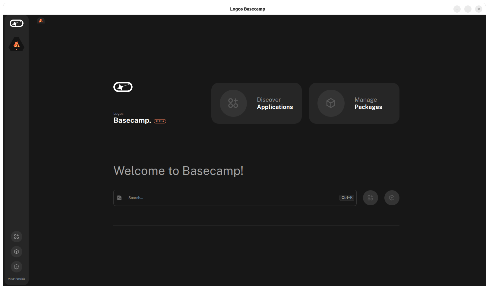

1. In the **Blockchain** category, select **Blockchain**.

   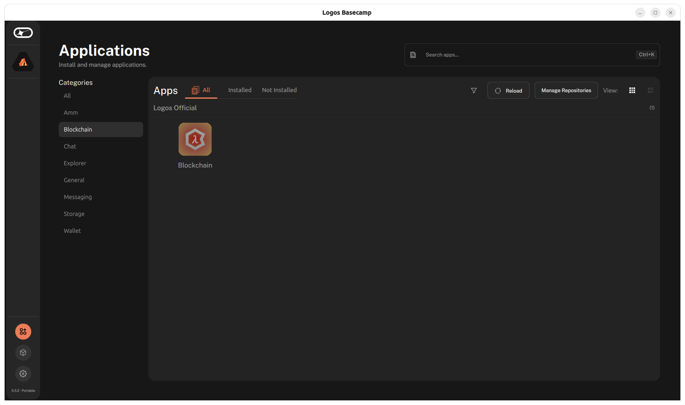

1. Make sure that `Blockchain` (the UI module) is set to `v0.3.2` and `Blockchain Module` (the core module) is set to `v0.3.2`, then click **Install**.

   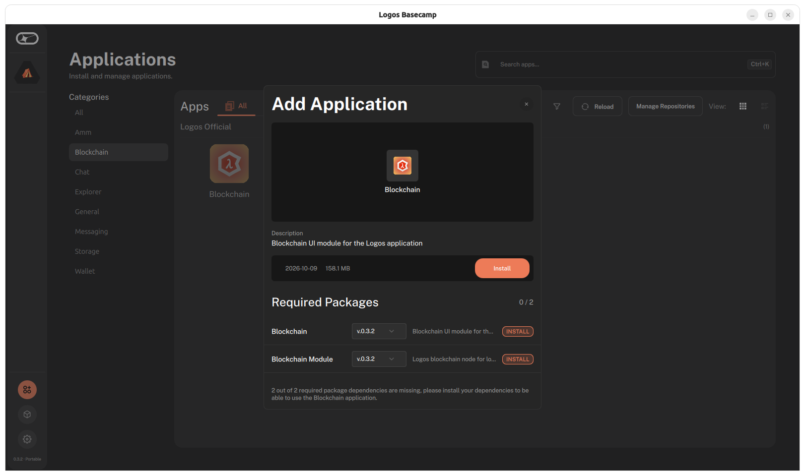

   :::note
   Individual [package](../../get-started/glossary.md#package) versions are pinned independently and do not necessarily match the testnet version number.
   :::

1. Once the modules are installed, press **Launch**.

   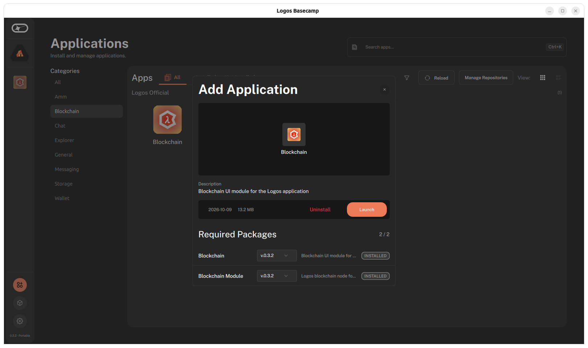

   - The Blockchain app will open.

## Step 2: Start the Node

On first run, the app opens on a welcome screen titled **Blockchain Node**. A node needs a config and a keystore before it can start.

The welcome screen offers **Quick start** and **Advanced**. [**Quick start**](#quick-start) generates a config for the public testnet with the bootstrap peers built into the release, creates your keys, and starts the node. To walk through the same choices one at a time, or to reuse a config you already have, click **Advanced** and follow [Step-by-step setup](#step-by-step-setup) instead.

   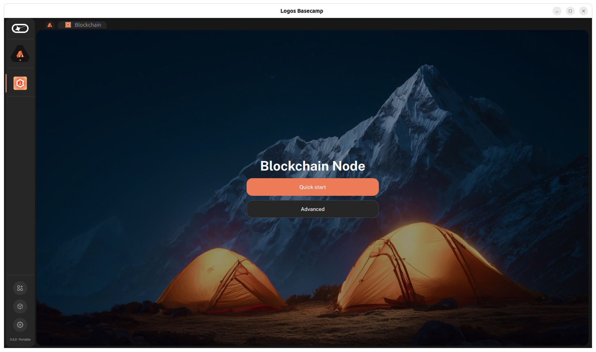

### Quick start

1.  Click **Quick start**.

   - The screen reads **Setting up your node…** while the app writes your config, creates your keys, and starts the node. The node view then opens.

1.  Open the **Settings** tab. Until you back up your keys, the **Node** tab shows a **Back up your keys** notice that points here.

1.  In the **Back up your keys** card, click **Download keystore.yaml** and choose where to save the copy.

   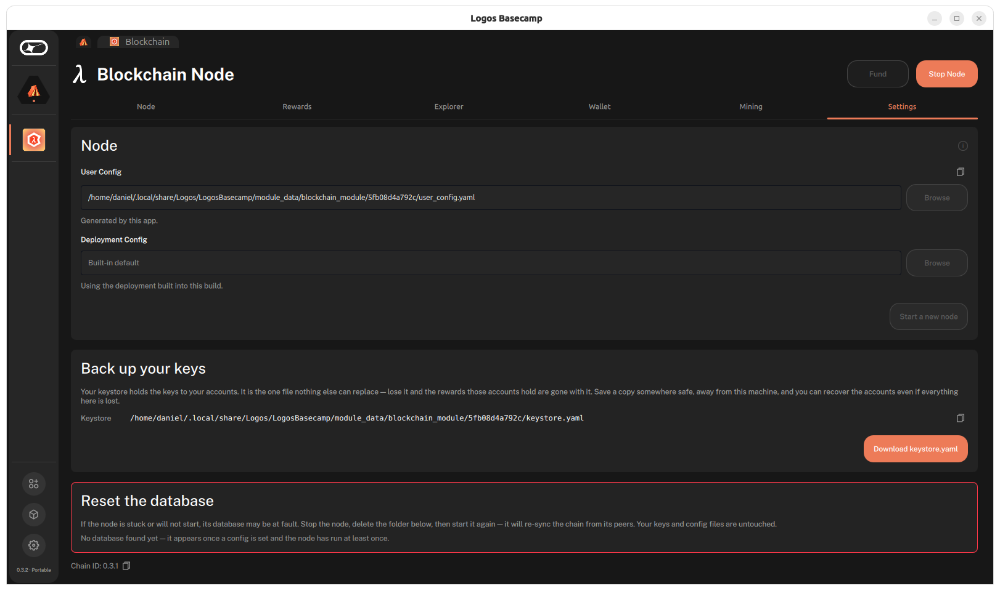

   - A **Keystore saved** message confirms the backup, and the card shows a **Done** badge.

   :::warning
   Your keystore holds the keys to your accounts, stake, and rewards. Nothing can reissue them. Keep the copy somewhere other than this machine.
   :::

### Step-by-step-setup

1. Click **Advanced**. The **Set up your node** wizard opens on step **1. Setup**.

1. Under **How do you want to start?**, select **Generate a new node** and click **Continue**.

   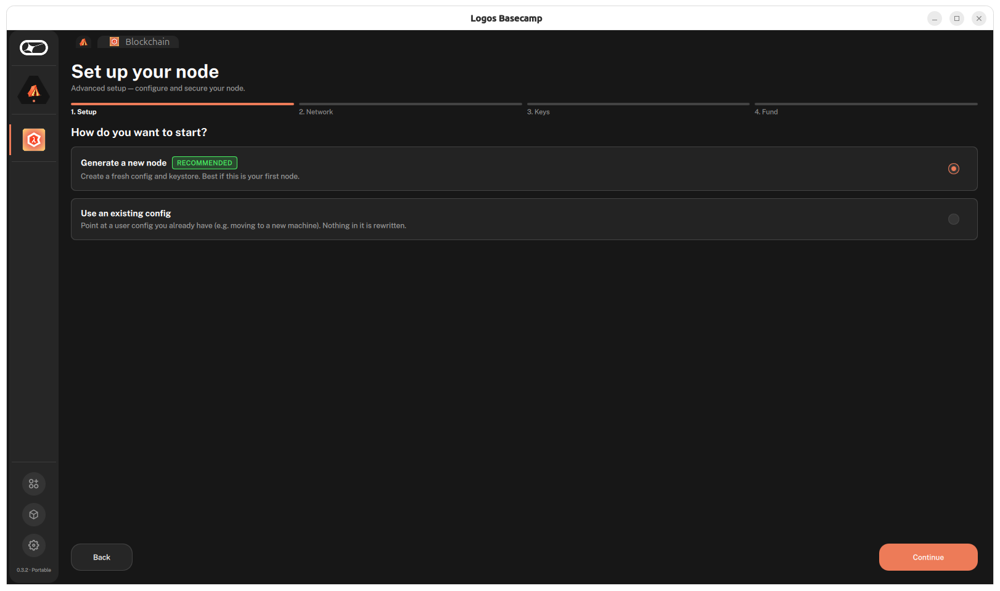

   - To reuse files you already have, select **Use an existing config** instead, fill in **User config** (and optionally **Deployment**) under **Point to your files**, and click **Start node**. The wizard ends there.

1. On **2. Network**, leave **Default (public testnet)** selected. The **Bootstrap peers** field is already filled with the testnet peers built into the release. A custom deployment file or different bootstrap peers can also be provided via this page. Click **Generate config** to proceed.

   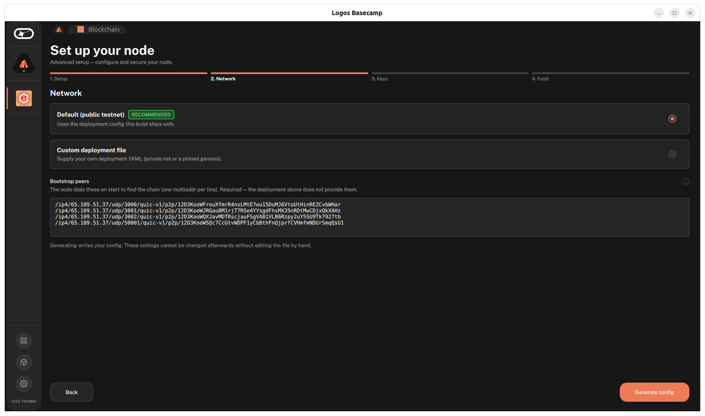

   :::caution
   A config generated with an empty **Bootstrap peers** field produces a node that starts and reports success but never syncs. Make sure the peers above are present before generating.
   :::

1. On **3. Keys**, click **Download keystore.yaml** and save the copy somewhere safe. Select **I've backed up my keys somewhere safe**, then click **Continue**.

   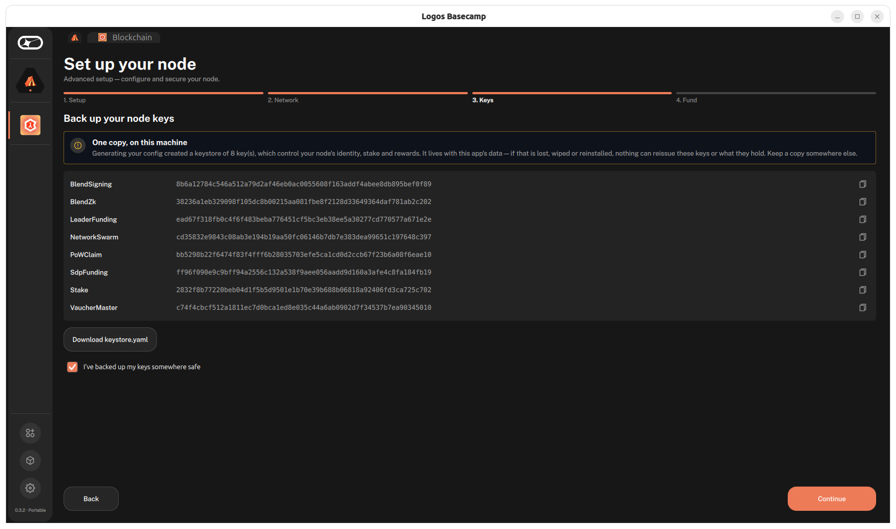

1. To participate in consensus, your node needs some testnet notes. Notes can be obtained by engaging in PoW mining. On **4. Fund**, choose whether the node claims mined rewards automatically:

   - Leave **Claim mined rewards automatically** on. With this approach, your node will repeatedly claim more notes until the target accounts reach their cap. **Pays into** already lists the target from your generated config: your **PoWClaim** account, with **No cap**. To pay into another account as well, choose it, set a threshold or switch on **No cap**, and click **Add**.
   - Alternatively, switch it off. You can still mine with the **Fund** button and claim rewards yourself from the **Mining** tab.

   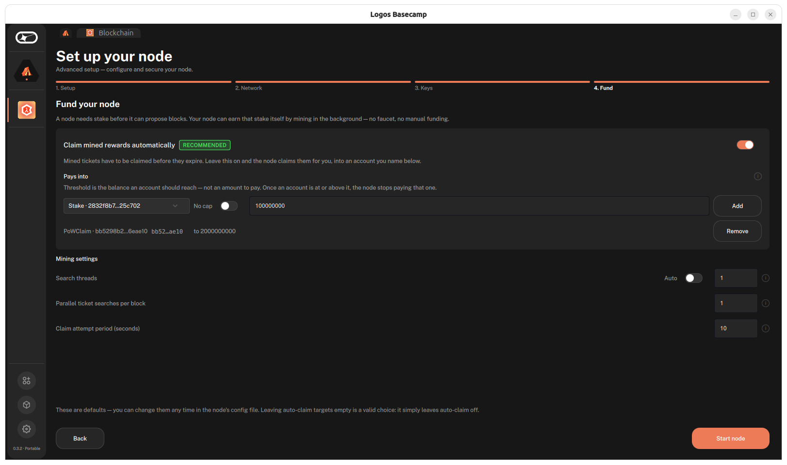

   :::tip
   Keeping all the defaults on this page is the recommended approach.
   :::

1. Click **Start node**. The app saves your mining settings, starts the node, and opens the node view.

## Step 3: Verify that the node is syncing

The **Node** tab shows the node's consensus status as a headline, with a lifecycle lane underneath it (**Started**, **Online**, **Funded**, **Aged**, **Proposing**, **Earning**) that lights up one stage at a time.

1.  Watch the headline. It moves from **Starting** to **[Bootstrapping](../../get-started/glossary.md#bootstrapping)** (**Syncing with the chain**) while the node catches up, then to **Online** (**Following the chain**).

   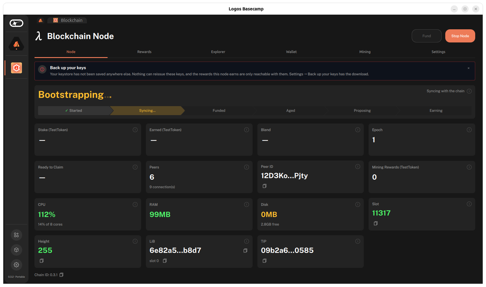

   :::note
   If you were offline for a while, expect the node to sit in *Bootstrapping* while it catches up before it reports *Online*. A height that is far below the current [slot](../../get-started/glossary.md#slot) during initial sync is normal.
   :::

1.  Check the **Peers** tile. It shows the number of connected peers, and should be greater than `0`.

1.  Check the **Height** tile. Expect it to increase by about one block every 10 seconds once the node is **Online**. The timing is probabilistic, so some variance is normal.

   - You can compare the height with the [testnet block explorer](https://testnet.blockchain.logos.co/web/explorer/).
   - The **Explorer** tab lists each new block that this node sees from now on.

## Step 4: Fund your node and propose blocks

A synced node validates the chain but does not propose blocks until its wallet holds testnet notes. Notes are obtained by PoW mining. 

1. Wait until the node reaches **Online** mode. The **Fund** button at the top right stays disabled until then.

   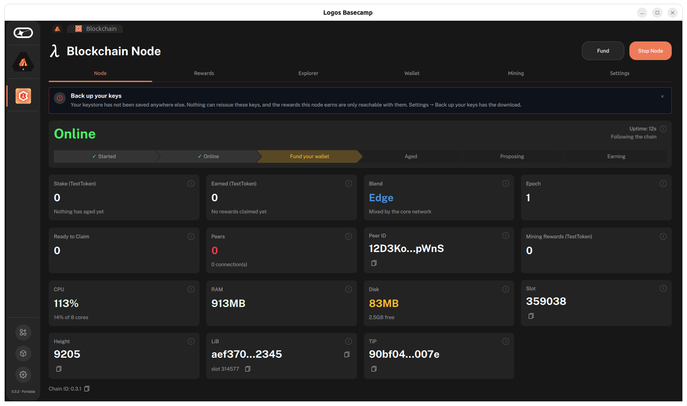

1. Click **Fund**. The node starts mining in the background and the button changes to **Stop Mining**.

   :::warning
   Mining uses CPU for as long as it runs. It does not stop by itself: click **Stop Mining** when you have enough funds.
   :::

1. Open the **Mining** tab to follow mined tickets. A ticket pays nothing until it is claimed, and expires if it never is claimed.

   - By default, the node claims tickets for you and pays them into your **PoWClaim** account, whether you used **Quick start** or step-by-step setup: the generated config lists that account as an auto-claim target.
   - If you switched auto-claim off during [step-by-step setup](#step-by-step-setup), claim tickets yourself under **Manual claim**.
   - The **Mining Rewards** tile on the **Node** tab shows how much has been claimed so far.

   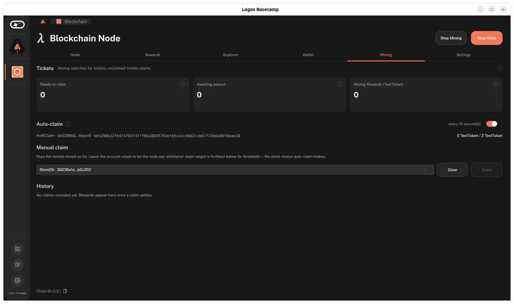

1. Open the **Wallet** tab, then click **Accounts**. Click **Refresh** and confirm the balance of your **PoWClaim** account, in TestToken.

   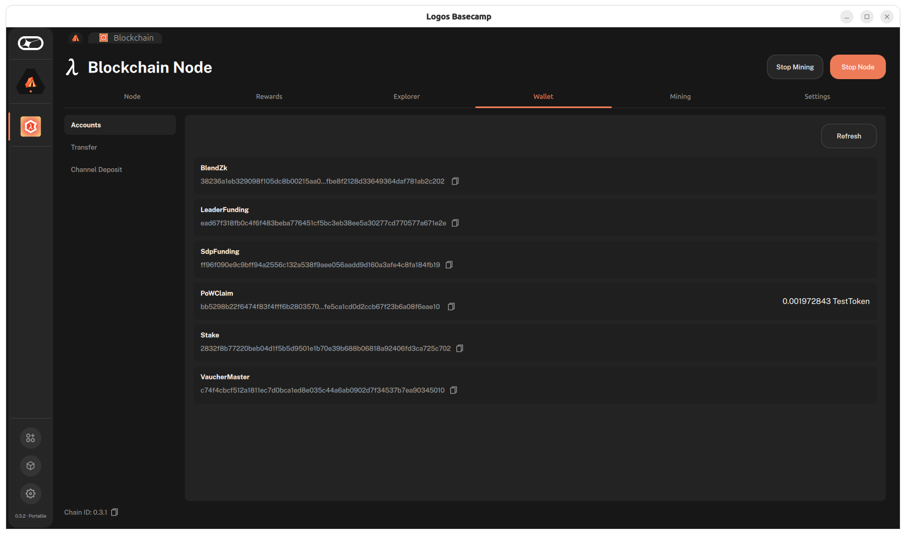

1. Once the wallet is funded, the **Stake** tile on the **Node** tab shows the value of the notes that have aged into the leadership lottery. Tokens can take up to two [epochs](../../get-started/glossary.md#epoch) (3.5 hours) to become eligible for consensus. After that, the node takes part in the consensus lottery automatically and starts proposing blocks. Confirm that your node is participating by checking that the headline has reached **Aged** and **Proposing**
   
   :::info
   Block proposal is probabilistic. Your node will not propose on every slot; participation depends on your stake relative to total active stake in the network.
   :::

1. Rewards appear under the **Rewards**, where **Claim** redeems them into your wallet.

   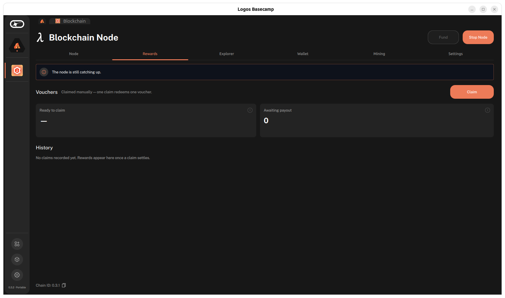

   :::note
   Participating in the [Blend network](../../get-started/glossary.md#blend-network) as a [*Core* node](../../get-started/glossary.md#core-node) requires a separate locked [note](../../get-started/glossary.md#note) (staked funds) and does not affect block proposing. See [Join the Blend network as a Core node](../blend/join-the-blend-network-as-a-core-node.md).
   :::

## Step 6: Keeping your node running

The node runs only while Basecamp is open, and it does not resume automatically after a restart. To restart your node, reopen Basecamp, open the blockchain module, and select **Start Node** again. For an unattended, always-on node, use the [CLI setup](./run-a-logos-blockchain-node-from-cli.md) with a service manager instead.

## Troubleshooting

### The welcome screen only offers Set up your node

The app hides **Quick start** when it has no bootstrap peers: either it could not read the peers built into its `metadata.json`, or it was built from `master`, which has none. Click **Set up your node** and follow [Step-by-step setup](#step-by-step-setup). On **2. Network**, the **Bootstrap peers** field will be empty: copy the testnet peers from the `Initialize Your Node` section of the [Logos Blockchain release notes](https://github.com/logos-blockchain/logos-blockchain/releases/latest) and paste them one per line. The release notes show them inside a CLI command: keep only the multiaddrs themselves, such as `/ip4/<ip>/udp/<port>/quic-v1/p2p/<peer-id>`, with no quotes, brackets, or commas.

### A dialogue says `Your config is out of date`

The config was written for an older release, so the node won't start with it. Testnet v0.3 starts a new chain, so configs from Testnet v0.2 need updating. Click **Update config**: the app rebuilds the config for this release and keeps your settings and keys. If the dialogue reads `This config can't be updated` instead, there is no keystore next to the config, and **Start fresh** creates a new config with a new set of keys.

### The headline stays in Bootstrapping mode

The node is still catching up, and the line beside the headline says why:

- `Catching up — replaying stored blocks.` or `Syncing with the chain`: wait. A first sync can take a while.
- `No block progress for 10 minutes — the node may have lost its peers. Try stopping and starting it.`: click **Stop Node**, then **Start Node**.
- `Genesis is … — the node can't finish syncing until then. Its config likely points at the wrong network.`: the config was generated for another network. In **Settings**, click **Start a new node** to generate a config for the public testnet.

If the node is stuck or will not start at all, the **Reset the database** card in **Settings** shows the database folder. Stop the node, delete that folder, then start the node again. It re-syncs the chain from its peers, and your keys and config files are untouched.

### The headline reads Node stopped or Disconnected

- **Node stopped** means the node process stopped unexpectedly. Click **Start Node**. If the same thing happens again, restart the app.
- **Disconnected** means the app lost contact with the node service. Restart the app.
