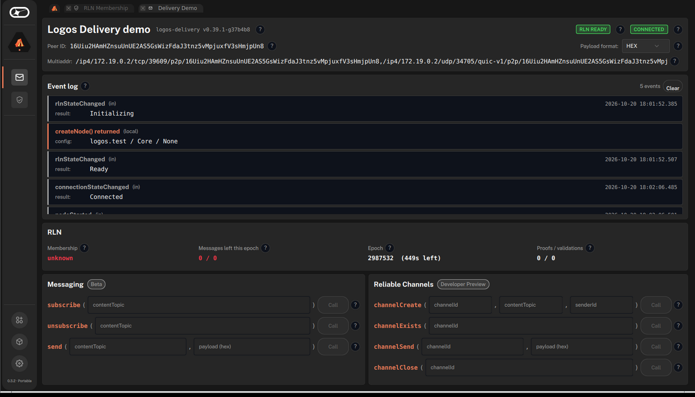
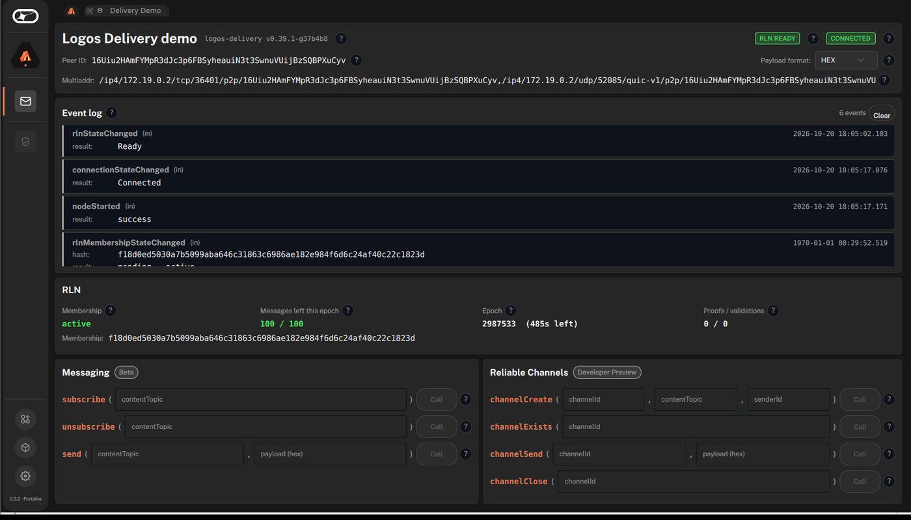

# Register an RLN membership from Basecamp

#### Get an RLN membership on the LEZ testnet for a delivery node running in Logos Basecamp.

:::tip[Version]
This document is accurate for **Testnet v0.3.1**.
:::

This procedure covers how to get an RLN membership on the [LEZ](../../get-started/glossary.md#lez) testnet registry for a Logos Delivery node that runs in Logos Basecamp. On the `logos.test` network, a node needs an active membership before any message it sends goes out. You create the node from the Delivery Demo [app](../../get-started/glossary.md#app), fund the payer account that the node derives, and the node registers its membership by itself. Use this procedure before you send messages on `logos.test` from Basecamp, for example with the Logos Chat app.

Registration pays with native tokens from the payer account. There is no faucet: you fund the payer yourself, for example by bridging tokens from the Logos Blockchain.

:::info[Prerequisites]

- [Logos Basecamp installed](../../basecamp/install-logos-basecamp.md).
- Network access to the testnet sequencer [`https://testnet.lez.logos.co/`](https://testnet.lez.logos.co/).
- A way to send `250000000` native units to an account on the LEZ testnet, such as Logos Blockchain notes that you can [bridge to the zone](../../blockchain/zone-sdk/bridge-assets-between-blockchain-and-zone.md).
- Approximately 1 GB free disk for the downloaded module packages.
:::

## What to expect

- You can create a `logos.test` delivery node in Basecamp and find the payer account it registers from.
- You can fund the payer and watch the node register its own membership, with no wizard and no faucet.
- You can confirm the membership's state and message quota in the **RLN** panel of Delivery Demo.

## Step 1: Install the Delivery Demo app

1. In Basecamp's **Package Manager**, find **Delivery Demo** in the official catalogue and click **INSTALL**.
1. In the **Install Package?** dialogue, click **Install**.

   - The dialogue lists `delivery_module` 0.4.0, `liblogos_lez_rln_module` 5.1.0, and `liblogos_rln_module` 0.12.0. These modules hold the node's wallet and register its membership. No extra package repository is needed.

   **Expected result:** the **Delivery Demo** row reads **INSTALLED**. If the row shows **RETRY**, click it once more.

## Step 2: Create the delivery node

1. Open **Delivery Demo** from the **Applications** grid.
1. In the `createNode` panel, keep `preset` set to `logos.test` and `mode` set to `Core`, then click **Call**.

   **Expected result:** the status badges read `RLN READY` and `CONNECTED`. The **RLN** panel shows **Membership** `unknown` and **Messages left this epoch** `0 / 0`, because the node has no membership yet.

   

## Step 3: Find the payer account

Creating the node also creates its LEZ wallet and derives a payer account from it. The payer pays for the registration.

1. Read the payer account ID from the wallet in Basecamp's data directory. On Linux, with the default data directory:

   ```bash
   cat ~/.local/share/Logos/LogosBasecamp/module_data/liblogos_lez_rln_module/*/wallet-home/payer.json
   ```

   **Expected result:** a 64-character hex account ID.

   - If you started Basecamp with `--user-dir <path>`, replace `~/.local/share/Logos/LogosBasecamp` with that path.
   - Basecamp's log also names the payer, in a line that reads `derived the payer <ACCOUNT> — it holds nothing until something transfers to it`.

1. Convert the account ID to the base58 form that the sequencer and LEZ wallets use. Replace `<ACCOUNT>` with the hex value:

   ```bash
   ACCOUNT=<ACCOUNT>
   python3 -c '
   import sys
   A = "123456789ABCDEFGHJKLMNPQRSTUVWXYZabcdefghijkmnopqrstuvwxyz"
   h = sys.argv[1]
   n, s = int(h, 16), ""
   while n:
       n, r = divmod(n, 58)
       s = A[r] + s
   print("1" * ((len(h) - len(h.lstrip("0"))) // 2) + s)' $ACCOUNT
   ```

## Step 4: Fund the payer account

To register, the payer must hold the registry's price plus a fee reserve: `182800000` native units in total at the testnet's minimum fee. Sending `250000000` leaves headroom. A registration spends about `75000000`, and the rest stays in the payer account.

1. Send `250000000` native units to the payer account.

   - To bridge from the Logos Blockchain, follow [Bridge assets between Logos Blockchain and a Zone](../../blockchain/zone-sdk/bridge-assets-between-blockchain-and-zone.md), with the payer account ID as the deposit's recipient. A deposit is credited on LEZ only once it is final on the blockchain, which takes about 10 hours on the current testnet.

1. Check the payer's balance. Replace `<BASE58>` with the value from Step 3:

   ```bash
   curl -sS -X POST -H 'Content-Type: application/json' \
     --data '{"jsonrpc":"2.0","method":"getAccountBalance","params":["<BASE58>"],"id":1}' \
     https://testnet.lez.logos.co/
   ```

   **Expected result:** `result` is at or above `182800000`.

## Step 5: Wait for the membership to register

The node registers its membership as soon as it sees a funded payer.

1. Keep Basecamp running with the node from Step 2.

   - If you closed Basecamp after Step 2, start it again, open **Delivery Demo**, and click **Call** in the `createNode` panel with the same values. The node finds the funded payer and registers.

1. Watch the **RLN** panel in Delivery Demo.

   **Expected result:** within a few minutes of the payer being funded, **Membership** reads `active`, **Messages left this epoch** reads `100 / 100`, and a **Membership** hash appears below.

   

The membership is stored with the node's wallet in Basecamp's data directory. Later launches of Basecamp pick it up, and nothing is registered or paid again.

## Troubleshooting RLN membership in Basecamp

### The RLN Membership app shows "Setup failed" with `bridge_failure: Call refused`

The **RLN Membership** app (`rln_membership_ui` 0.7.4) from the **Logos RLN Membership** package repository registers through a faucet that the current RLN modules no longer have. It can't complete on the current testnet. Register through a delivery node as described on this page instead. You can remove the **Logos RLN Membership** repository under **Manage Repositories**.

### Membership stays `unknown`

The payer holds less than `182800000`. Check its balance as in [Step 4](#step-4-fund-the-payer-account). A bridge deposit shows up on LEZ only about 10 hours after it is included on the blockchain.

### The balance check returns `0` long after a bridge deposit

The deposit isn't final on the blockchain yet. Wait, and check that the deposit's recipient was the payer account ID from [Step 3](#step-3-find-the-payer-account).
