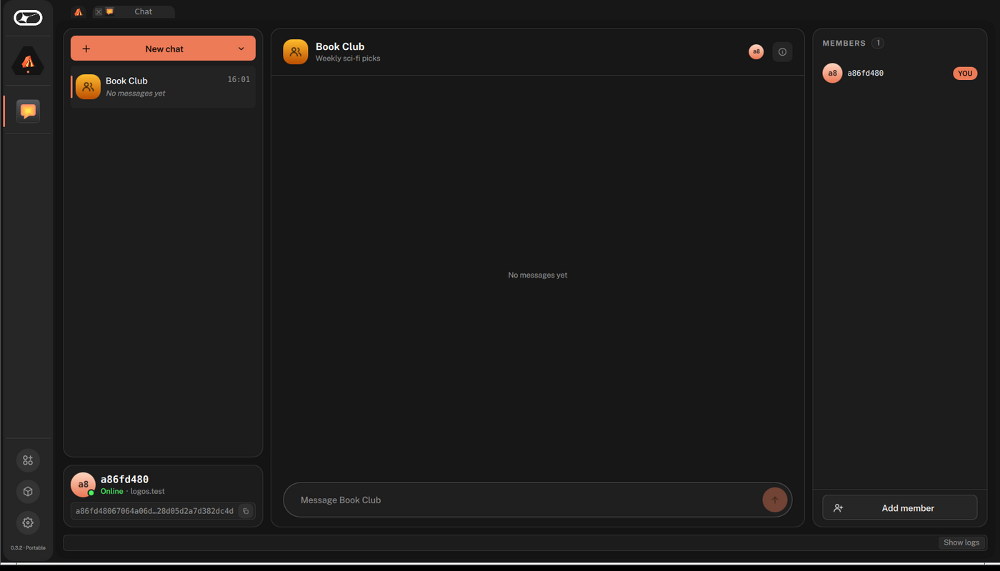
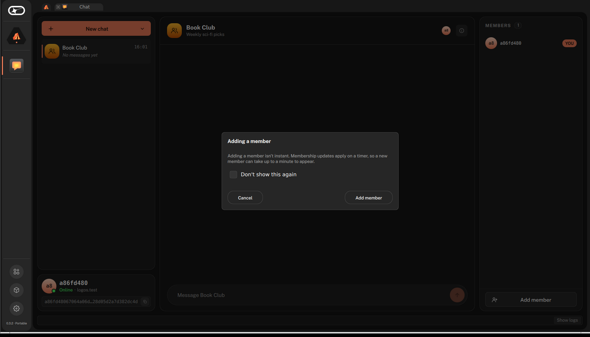
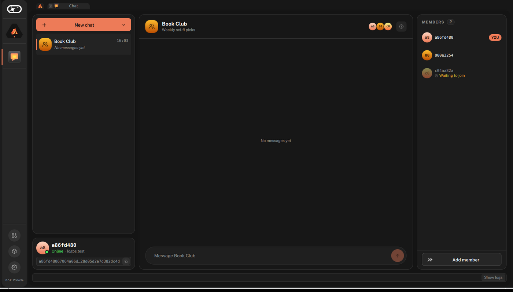
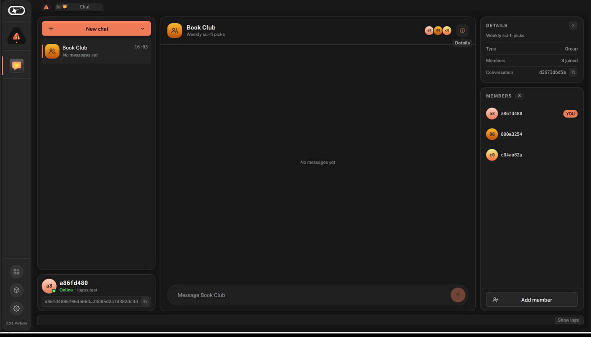
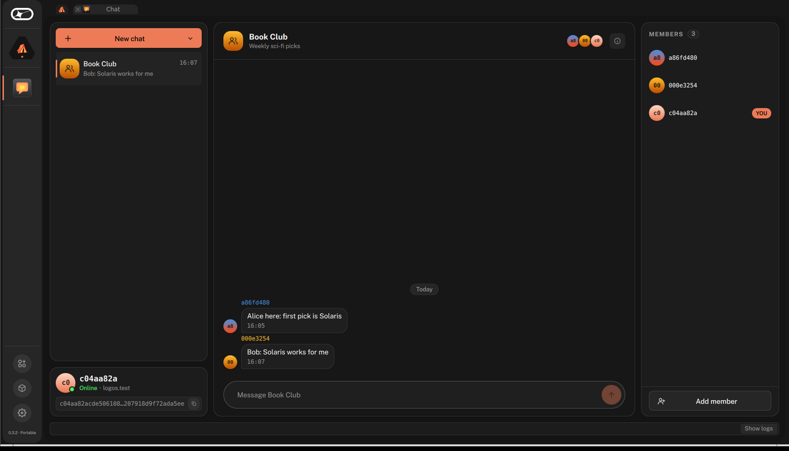

# Send group messages with the Logos Chat app

#### Create a three-member end-to-end encrypted group conversation in the Logos Chat app, invite members by address, and send a message that reaches all of them.

:::tip[Version]
This document is accurate for **Testnet v0.3.0**.
:::

This procedure shows how to use the [Logos Chat](../../get-started/glossary.md#logos-chat) app to form an end-to-end encrypted group conversation between three running instances, here called **Alice**, **Bob**, and **Carol**. Group conversations use de-MLS encryption from the [`logos-chat-module`](https://github.com/logos-co/logos-chat-module), and [Logos Delivery](../../get-started/glossary.md#logos-delivery) carries the encrypted messages between instances. Use this procedure to try group creation, invite-by-address, asynchronous membership changes, and messages that reach every member with their sender named.

Each launch of the app starts a new identity with a new address. Conversations from an earlier launch stay readable under **Previous sessions** but can't be sent to, and a group comes back only once a member invites your new address. A group's name and description are fixed when it is created, and in this release membership only grows: members can't be removed and can't leave.

:::info[Prerequisites]

- A supported OS:
   - Linux
   - macOS
- Network access, so that the three instances can reach the `logos.test` network and the key-package registry
- [Basecamp installed](../../basecamp/install-logos-basecamp.md).
- [RLN membership registered](../../lez/rln/register-rln-membership-from-basecamp.md).

:::

## What to expect

- You can send a message to a group conversation and see it arrive in every member's window with the sender's name and avatar.
- You can create a named group and invite members by pasting their addresses.
- You can watch an invited member move from **Waiting to join** to a full member as the group commits the change.

## Step 1: Run three instances of the Logos Chat app

One Basecamp instance is one chat identity, so use this option when the three participants are on separate machines.

1. In the left bar, select **Package Manager**.
1. Find **Chat** in the [package](../../get-started/glossary.md#package) list and click **INSTALL** in its row. Click **Install** in the **Install Package?** dialogue to confirm, along with the `chat_module` and `delivery_module` packages it depends on.
1. Wait until the **Action** column reads **INSTALLED** for both **Chat** and **Chat Module**.
1. In the left bar, select the chat icon to launch the Logos Chat app.

## Step 2: Collect Bob's and Carol's addresses

**In Bob's and Carol's windows:**

1. Wait until the account card shows **Online**.
1. Click the copy button next to the address on the account card (**Copy my address**).
1. Send the address to Alice through any [out-of-band](../../get-started/glossary.md#out-of-band) communication channel.

## Step 3: Create the group

**In Alice's window:**

1. Click **New chat** at the top of the conversations card, then select **Group** ("Named, with members").
1. Fill in **Group name**, for example `Book Club`, and optionally **Description (optional)**, for example `Weekly sci-fi picks`. Neither can be changed after creation.
1. Click **Create**.

   **Expected result:** the group opens as the current conversation, with Alice as its only member. A right-hand column appears with the **Members** roster and **Add member** at its foot.

   

## Step 4: Invite Bob

Membership changes are asynchronous. The group's steward batches an add into an MLS commit after a commit-inactivity window of about 60 seconds, and the welcome goes out only after the commit lands, so a new member joins minutes after the invite. Wait for Bob to join before inviting Carol, so that the second add starts from a settled group.

**In Alice's window:**

1. In the **Members** card, click **Add member**.
1. Paste Bob's address, then click **Add**.
1. An explainer appears: "Adding a member isn't instant. Membership updates apply on a timer, so a new member can take up to a minute to appear." Click **Add member** to confirm.

   

   - Select **Don't show this again** to skip the explainer next time.

   **Expected result:** Bob appears on Alice's roster as a dimmed row reading **Waiting to join**. Some minutes later, the group appears in Bob's conversation list with the name Alice gave it, and his row on the roster stops being dimmed.

## Step 5: Invite Carol

1. In Alice's window, repeat [Step 4](#step-4-invite-bob) with Carol's address.

   - Any member can add another; the invite routes from whoever proposed it.

   

1. Wait until the group appears in Carol's conversation list.

   **Expected result:** all three rosters converge on three members, none of them dimmed or reading **Waiting to join**. The conversation's **Details** panel, opened with the toggle in the thread header, shows **3 joined**.

   

## Step 6: Send a message to the group

1. In Alice's window, select the group, type a message in the composer, and press `Enter` or click the send arrow.

   **Expected result:** the message appears right-aligned in Alice's thread. Within a few seconds to about two minutes, it appears in Bob's and Carol's threads as an incoming, left-aligned message with Alice's avatar and name above it. Sender attribution is what distinguishes a group thread from a direct message.
1. In Bob's window, reply to the group.

   **Expected result:** Bob's reply reaches both Alice and Carol.

   

## Troubleshooting Logos Chat groups

### An invited member stays on the roster as "Waiting to join" for minutes

This is by design, not a hang. The add is a consensus proposal that the group's steward batches into an MLS commit after a commit-inactivity window of about 60 seconds, and the welcome only goes out after the commit lands. Wait, and invite one member at a time, letting each join land before the next invite.

### A send fails right after a membership change

de-MLS rejects sends during the brief window while the group finalises the epoch change. The failure shows on the status bar at the foot of the window. Retry after a few seconds.

### The account card never reaches Online, or the conversations pane shows "Waiting for connection…"

The instance has no route to the `logos.test` fleet or to the key-package registry, for example because it is offline, sandboxed, or has its peer-to-peer ports blocked. Run it with real network access. The session logs, under **Logs** or **Full logs** in the app, say which module failed and where its log file is.

### Two instances on one host interfere with each other

They were given the same session directory. Give each instance its own `--user-dir`.
